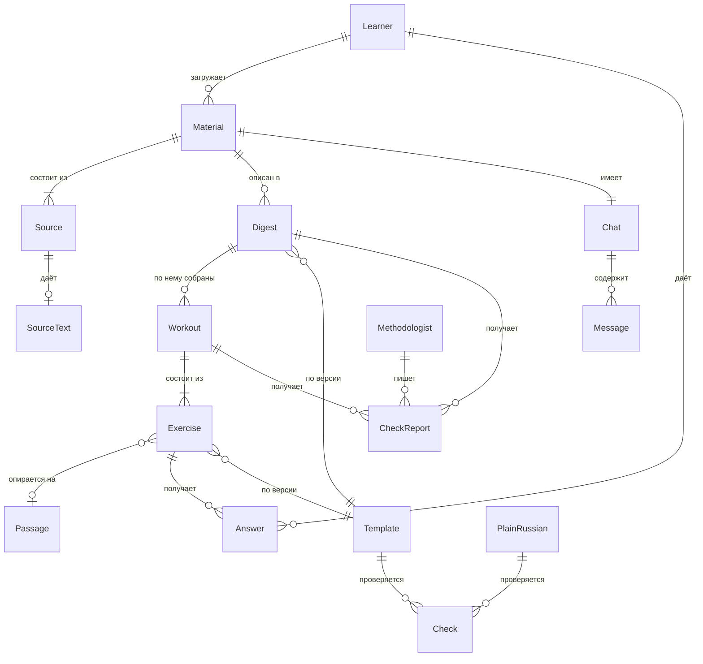

# Доменная модель: первая версия

Термины взяты из `GLOSSARY.md`. Принятые решения собраны в разделе «Решения», спорное — в «Открытых вопросах».

## Сущности и связи

| Сущность         | Что хранит                                        | Кто создаёт                 |
| ---------------- | ------------------------------------------------- | --------------------------- |
| Ученик           | профиль, изучаемый язык                           | регистрация (Better Auth)   |
| Материал         | название, статус обработки, дата                  | Ученик                      |
| Исходник         | вид (файл или ссылка), MIME, размер, статус       | Ученик                      |
| Текст исходника  | сырой текст, способ извлечения                    | система                     |
| Конспект         | текст, версия шаблона, версия стиля               | Репетитор                   |
| Чат, Реплика     | автор, текст, время                               | Ученик и Репетитор          |
| Тренировка       | список упражнений, статус                         | Репетитор                   |
| Упражнение       | вид, условие, ключ ответа, опорный текст          | Репетитор                   |
| Опорный текст    | текст, происхождение (написан или найден), ссылка | Репетитор                   |
| Ответ            | текст или аудио, оценка, разбор ошибок            | Ученик, оценивает Репетитор |
| Шаблон           | разделы, версия                                   | команда продукта            |
| Простой русский  | правила стиля, версия                             | команда продукта            |
| Проверка         | правило, к чему относится, строгость              | команда продукта            |
| Отчёт о проверке | пройденные проверки, найденные ошибки, правки     | Методист                    |

Артефакт — это роль, а не отдельная таблица. Конспект и Упражнение играют эту роль: у обоих есть шаблон и версия стиля. Отчёт о проверке Методист пишет на Конспект и на Тренировку целиком, потому что ошибка может быть в связке упражнений, а не в одном.

## Репетитор и Методист

Оба — части системы на LLM, но с разными задачами. Репетитор пишет, Методист проверяет. Методист не пишет текст сам, он только находит ошибки и говорит, что исправить.

Что ищет Методист:

- Конспект: факты расходятся с текстами исходников, что-то важное потеряно, нарушен шаблон, текст не на простом русском.
- Тренировка: неверный ключ ответа, у упражнения два правильных ответа, ошибки в языке опорного текста, упражнение проверяет то, чего нет в конспекте, нарушен шаблон.

Конспект Методист сверяет с текстами исходников, а не с самим конспектом. Иначе он не заметит, что Репетитор что-то выдумал. Тренировку он сверяет с конспектом, из которого она собрана.

Методист проверяет только Конспекты и Тренировки. Реплики в чате и оценку Ответов Репетитор делает сам, без проверки.

## Жизненный цикл

Исходник: `загружен → текст извлечён` или `загружен → ошибка` (формат не читается, файл слишком большой, ссылка недоступна).

Материал: `загружен → обрабатывается → конспекты готовы → тренировка готова`. Тренировка собирается из готового конспекта, поэтому всегда идёт после него. Если хоть один исходник упал, материал всё равно идёт дальше с остальными. Так ли это — открытый вопрос.

Сбой: Репетитор или Методист недоступны, и текста нет совсем. Ученик видит ошибку и кнопку «Повторить». Повтор запускает обработку заново на уже загруженных исходниках, файлы заново грузить не надо. Если сами файлы не загрузились, повторять нечего: Ученик загружает их снова.

Конспект и Тренировка: `черновик → проверка Методиста → (правка Репетитора → проверка Методиста) × N → показан Ученику`. N — число кругов правки, это настройка, по умолчанию 1. Ученик видит итог в любом случае, даже если после последнего круга ошибки остались.

## Экраны первой версии

1. **Пустая главная.** Ученик ещё ничего не загрузил. Есть одна кнопка «Загрузить материал».
2. **Окно загрузки.** Модальное окно. Перетащить файлы, вставить ссылки, по желанию дать название. Кнопка «Отправить репетитору».
3. **Карточка материала.** Главный экран.
   - Слева: меню всех материалов Ученика, клик открывает карточку. Кнопка «Загрузить материал» тоже здесь.
   - В центре: чат с Репетитором. Репетитор пишет, что он сейчас делает, и показывает готовые конспекты.
   - Справа или во вкладках: список исходников со статусами, список конспектов, тренировки.
4. **Конспект.** Чтение одного конспекта. Ссылки на исходники, из которых он сделан.
5. **Тренировка.** Упражнения по одному. Поле ответа: текст или запись голоса. После ответа Репетитор показывает разбор.
6. **Мастерская шаблонов.** Для команды продукта, не для Ученика. Редактор шаблонов, правил простого русского и проверок. Прогон на эталонных материалах, отчёты Методиста, сравнение двух версий шаблона.

Первая фича — экраны 1–3 и конспекты. Тренировки и мастерская идут следом.

## Виды упражнений для старта

Кандидаты из привычной методики преподавания языков. Набор для первой версии ещё не выбран.

- Диалог: живой диалог носителей на тему материала, потом вопросы или роли.
- Пересказ: прочитать опорный текст и пересказать письменно или голосом.
- Вопросы к тексту: ответить на вопросы по опорному тексту.
- Раскрой скобки: поставить слово в нужную форму.
- Заполни пропуски, сопоставь пары, расставь по порядку, переведи фразу.

## Как настраивать стиль и шаблоны

Цель — быстро пробовать разные форматы и выбрать лучший. Подход, который стоит обсудить:

- Шаблон и правила простого русского лежат как файлы с версиями (Markdown и YAML), а не в коде промпта.
- Проверки двух сортов. Простые считает код: есть ли все разделы, длина предложений, индекс читаемости, запретные слова. Сложные (факты, смысл, верность ключей) оценивает Методист. Простые идут первыми, чтобы не тратить вызовы Методиста на явный брак.
- Каждый артефакт помнит версию шаблона и стиля, по которой написан. Тогда версии можно сравнивать на одних и тех же материалах.
- Набор эталонных материалов прогоняется после каждой правки шаблона, как тесты.

## Открытые вопросы

1. Приложение только для изучения языков или для любого предмета? От этого зависят виды упражнений и сам конспект.
2. Конспект один на материал или по одному на каждый исходник? Если их несколько, по какому собирается Тренировка?
3. Можно ли добавить исходник в уже загруженный материал? Можно ли удалить?
4. Тренировка одна на материал или Ученик может попросить новую? Может ли тренировка опираться на несколько материалов?
5. Что Ученик может делать в чате: задать вопрос по материалу, попросить переписать конспект, попросить другую тренировку?
6. Пишет ли Репетитор реплики в чате на простом русском? Методист их не проверяет, это решено.
7. Опорный текст из интернета: как соблюдать авторские права и хранить ссылку на источник?
8. Что делать, если загружен материал не по теме (счёт за свет, мем)?
9. Ограничения: размер файла, длина видео, число исходников, стоимость обработки на одного Ученика.
10. Кто правит шаблоны и правила в первой версии: команда меняет файлы в репозитории или нужен экран мастерской?

## Решения

| Вопрос                                                 | Решение                                                                   |
| ------------------------------------------------------ | ------------------------------------------------------------------------- |
| Кто такой Методист                                     | Часть системы на LLM. Проверяет Конспекты и Тренировки до показа Ученику. |
| Сколько кругов правки                                  | Настройка, по умолчанию 1.                                                |
| Что видит Ученик, если ошибки остались                 | Итог последнего круга. Ученику всегда показываем то, что получилось.      |
| Что видит Ученик, если текста нет совсем               | Ошибку и кнопку «Повторить». Повтор не требует заново грузить исходники.  |
| Проверяет ли Методист чат и оценку Ответов             | Нет. За них отвечает только Репетитор.                                    |
| Видит ли Ученик статус проверки, может ли пожаловаться | Нет, в первой версии этого нет.                                           |
| Из чего собирается Тренировка                          | Из Конспекта.                                                             |
