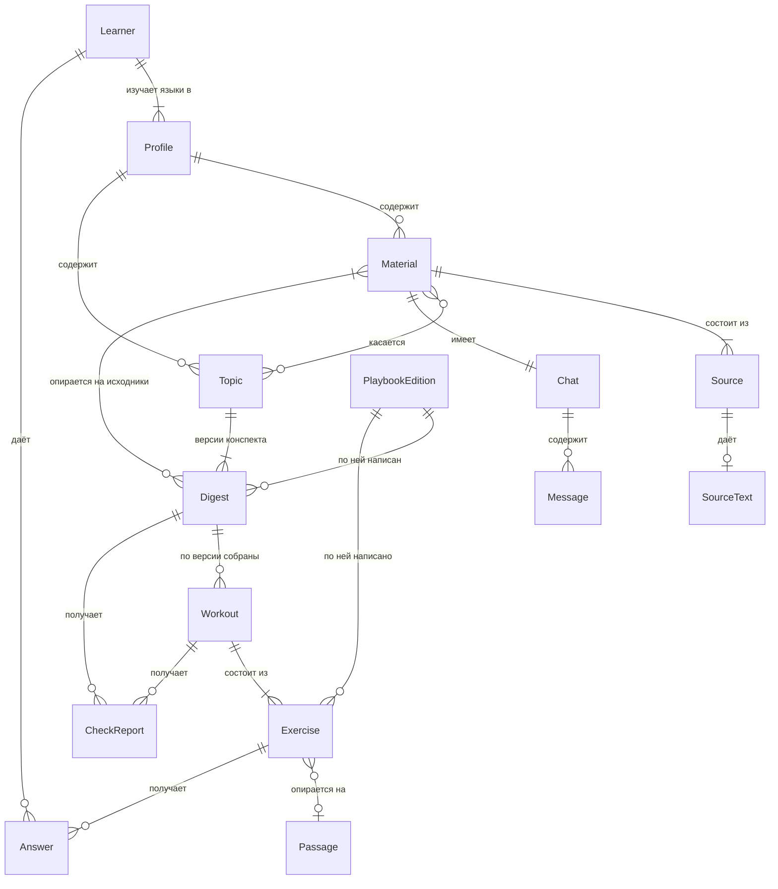

# Доменная модель: вторая версия

Термины взяты из `GLOSSARY.md`. Принятые решения собраны в разделе «Решения», спорное — в «Открытых вопросах».

## Сущности и связи

Методичка (Шаблоны, Простой русский, глоссарий, инструкции, Проверки) — файлы в `content/`, а не таблицы. Редакция методички — хеш содержимого `content/`, его хранит каждый Артефакт. Команда — роль аккаунта Better Auth, не отдельная сущность.

| Сущность         | Что хранит                                                   | Кто создаёт                 |
| ---------------- | ------------------------------------------------------------ | --------------------------- |
| Ученик           | аккаунт, роль (Ученик или Команда)                           | регистрация (Better Auth)   |
| Профиль          | изучаемый язык (название — по языку)                         | Ученик                      |
| Материал         | название, статус обработки, дата, стоимость обработки        | Ученик                      |
| Исходник         | вид, MIME, размер, статус, причина ошибки                    | Ученик                      |
| Текст исходника  | сырой текст, способ извлечения, отметки времени для аудио    | worker                      |
| Тема             | название, краткое описание                                   | Репетитор                   |
| Конспект         | версия, текст, Редакция методички, Материалы-источники       | Репетитор                   |
| Чат, Реплика     | автор, текст, время                                          | Репетитор                   |
| Тренировка       | версия Конспекта, список упражнений, статус                  | Репетитор                   |
| Упражнение       | вид, условие, ключ ответа, опорный текст, Редакция методички | Репетитор                   |
| Опорный текст    | текст, происхождение (написан или найден), ссылка            | Репетитор                   |
| Ответ            | текст или аудио, оценка, разбор ошибок                       | Ученик, оценивает Репетитор |
| Отчёт о проверке | пройденные проверки, найденные ошибки, правки                | Методист и Проверки кодом   |

Артефакт — это роль, а не отдельная таблица. Конспект и Упражнение играют эту роль: оба помнят Редакцию методички, по которой написаны. Отчёт о проверке Методист пишет на Конспект и на Тренировку целиком, потому что ошибка может быть в связке упражнений, а не в одном.

## Репетитор и Методист

Оба — части системы на LLM, но с разными задачами. Репетитор пишет, Методист проверяет. Методист не пишет текст сам, он только находит ошибки и говорит, что исправить.

Что ищет Методист:

- Конспект: факты расходятся с текстами исходников, что-то важное потеряно, нарушен шаблон, текст не на простом русском.
- Темы: материал отнесён к чужой теме (например, «Pretérito indefinido» склеен с «Pretérito imperfecto») или заведена тема, которая уже есть в профиле. Сверяет со списком тем профиля.
- Тренировка: неверный ключ ответа, у упражнения два правильных ответа, ошибки в языке опорного текста, упражнение проверяет то, чего нет в конспекте, нарушен шаблон.

Конспект Методист сверяет с текстами исходников, а не с самим конспектом. Иначе он не заметит, что Репетитор что-то выдумал. Тренировку он сверяет с конспектом, из которого она собрана.

Методист проверяет только Конспекты и Тренировки. Реплики в чате и оценку Ответов Репетитор делает сам, без проверки.

## Жизненный цикл

Каждый поток ниже — машина XState в `libs/flows` (ADR 0004). Служебная страница для Команды рисует их диаграммы.

Исходник: `загружен → в очереди → извлекается → текст извлечён` или `→ ошибка` с причиной (не читается, временная ошибка распознавания, 3 попытки исчерпаны).

Материал: `загружен → в очереди → обрабатывается → темы готовы`, либо `→ без тем` (нет учебного содержания), либо `→ ошибка` (не прочитался ни один исходник). Если упала часть исходников, материал идёт дальше с остальными. Материалы одного Профиля обрабатываются строго по очереди.

Сбой: Репетитор или Методист недоступны. Ученик видит ошибку и кнопку «Повторить». Повтор продолжает с упавшего шага, файлы заново грузить не надо.

Тема в Материале: Репетитор относит содержание к новой или существующей Теме Профиля. Новая Тема получает первую версию Конспекта, существующая — следующую версию.

Версия Конспекта: `черновик → Проверки кодом → проверка Методиста → (правка Репетитора → Проверки кодом → проверка Методиста) × N → показана Ученику`. Провал Проверок кодом Репетитор правит сразу, без Методиста, и это не круг правки. N — число кругов правки, по умолчанию 1. Ученик видит итог в любом случае.

## Экраны первой версии

1. **Выбор Профиля.** При первом входе Ученик выбирает изучаемый язык. Потом — список Профилей по языкам.
2. **Пустая главная Профиля.** Одна кнопка «Загрузить материал».
3. **Окно загрузки.** Перетащить файлы (PDF, фото, документы, аудио, видео), по желанию дать название. Кнопка «Отправить репетитору». Файлы идут прямо в R2.
4. **Карточка материала.** Главный экран.
   - Слева: меню Профиля из двух списков, «Материалы» и «Темы». Кнопка «Загрузить материал».
   - В центре: Чат только для чтения. Репетитор пишет, что делает, какие Темы нашёл и что дополнил.
   - Рядом: исходники со статусами, Темы этого материала с пометками «новая» или «дополнена».
5. **Конспект Темы.** Последняя версия. Ссылки на Тексты исходников, для аудио и видео — с отметкой времени. Для сербского — переключатель латиница/кириллица.
6. **Диаграммы процессов.** Только для Команды: все сценарии и кто отвечает за каждый шаг.
7. **Тренировка.** Следующая фича.

Первая фича — экраны 1–6.

## Виды упражнений для старта

Кандидаты из привычной методики преподавания языков. Набор для первой версии ещё не выбран.

- Диалог: живой диалог носителей на тему материала, потом вопросы или роли.
- Пересказ: прочитать опорный текст и пересказать письменно или голосом.
- Вопросы к тексту: ответить на вопросы по опорному тексту.
- Раскрой скобки: поставить слово в нужную форму.
- Заполни пропуски, сопоставь пары, расставь по порядку, переведи фразу.

## Методичка

Шаблоны, Простой русский, глоссарий, инструкции Репетитора и Методиста и Проверки кодом лежат файлами в `content/` (ADR 0005). Каждый Артефакт помнит Редакцию методички. Эталонные материалы Команда загружает через обычный UI и сравнивает результаты разных Редакций.

## Открытые вопросы

Вопросы первой фичи «Загрузить материал» закрыты.

## Отложено на следующие фичи

1. Тренировки: минимальный набор видов упражнений; как Репетитор оценивает письменный и голосовой Ответ; может ли Ученик попросить новую Тренировку по Теме; может ли Тренировка охватывать несколько Тем.
2. Опорные тексты из интернета: авторские права и ссылка на источник.
3. Чат с вводом: вопросы по материалу, просьбы переписать Конспект, слить или разделить Темы; контекст и стоимость ответов.
4. Ссылки на YouTube. Скачивать запрещено условиями YouTube; законный путь — Gemini по ссылке.
5. Слайды и доска в видео: смена кадров, отсев дублей, распознавание кадров.
6. Редактор Методички в UI и хранение вне репозитория. Вариант по исследованию — свой, на D1 и CodeMirror (`docs/research/content-editor.md`).
7. Удаление Профиля со всем содержимым: подтверждение и судьба файлов в R2.
8. Политика передачи данных внешним провайдерам — перед привлечением клиентов.
9. Переезд worker'а в облако: Cloud Run Jobs или Northflank, тот же бинарник (`docs/research/model-selection.md`).
10. Живой статус Материала на служебной странице диаграмм.

## Решения

| Вопрос                                                 | Решение                                                                                                                                                                                                                                                               |
| ------------------------------------------------------ | --------------------------------------------------------------------------------------------------------------------------------------------------------------------------------------------------------------------------------------------------------------------- |
| Кто такой Методист                                     | Часть системы на LLM. Проверяет Конспекты и Тренировки до показа Ученику.                                                                                                                                                                                             |
| Сколько кругов правки                                  | Настройка, по умолчанию 1.                                                                                                                                                                                                                                            |
| Что видит Ученик, если ошибки остались                 | Итог последнего круга. Ученику всегда показываем то, что получилось.                                                                                                                                                                                                  |
| Что видит Ученик, если текста нет совсем               | Ошибку и кнопку «Повторить». Повтор не требует заново грузить исходники.                                                                                                                                                                                              |
| Проверяет ли Методист чат и оценку Ответов             | Нет. За них отвечает только Репетитор.                                                                                                                                                                                                                                |
| Видит ли Ученик статус проверки, может ли пожаловаться | Нет, в первой версии этого нет.                                                                                                                                                                                                                                       |
| Из чего собирается Тренировка                          | Из Конспекта.                                                                                                                                                                                                                                                         |
| Только языки или любой предмет                         | Только иностранные языки. Конспект пересказывает содержание, Тренировка учит языку на нём.                                                                                                                                                                            |
| Сколько Конспектов на Материал                         | По одному на каждую Тему. Репетитор сам делит Материал на Темы.                                                                                                                                                                                                       |
| Можно ли менять Исходники после загрузки               | Нет. Материал неизменяем, удалить можно только целиком.                                                                                                                                                                                                               |
| Если часть Исходников не прочиталась                   | Идём дальше с прочитанными, Репетитор сообщает в Чате. Ни одного — ошибка Материала.                                                                                                                                                                                  |
| Где живут Шаблоны, Простой русский, Проверки           | Пока файлы в репозитории, правки через PR. Редактор в UI — позже.                                                                                                                                                                                                     |
| Лимиты загрузки                                        | PDF и фото без лимита размера. Видео урока до 1 ГБ и до 2 часов. Число файлов не ограничено.                                                                                                                                                                          |
| Какие Исходники принимает первая фича                  | PDF, фото, документы, аудио и видеофайлы. Ссылки на YouTube — в следующей фиче.                                                                                                                                                                                       |
| Потолок размера файла                                  | 1 ГБ на любой файл. Страницы не ограничиваем; длинный PDF — предупреждение в Чате.                                                                                                                                                                                    |
| Что берём из видео                                     | Только речь. Доску и слайды не читаем (может измениться по итогам исследования видео).                                                                                                                                                                                |
| Как идёт Обработка                                     | В фоне (Cloudflare Workflows). Статус в Карточке материала, уведомлений нет.                                                                                                                                                                                          |
| Кто делит Материал на Темы                             | Репетитор. Ученик в первой версии деление не меняет.                                                                                                                                                                                                                  |
| Откуда Изучаемый язык                                  | Ученик выбирает при первом входе. Для нескольких языков — несколько профилей.                                                                                                                                                                                         |
| Одинаковые загрузки                                    | Это два Материала. Дедупликации файлов нет, но Темы в конспектах не должны повторяться.                                                                                                                                                                               |
| Чат в первой фиче                                      | Только чтение: статусы и Конспекты от Репетитора. Поля ввода нет.                                                                                                                                                                                                     |
| Несколько языков у Ученика                             | Один Профиль на язык, название — по языку. При входе Ученик выбирает Профиль; если язык один, Профиль один.                                                                                                                                                           |
| Повтор Темы в новом Материале                          | Тема общая на Профиль. Новый Материал дополняет существующий Конспект, тот получает новую версию.                                                                                                                                                                     |
| Какие документы принимаем                              | docx, odt, rtf, txt, md, pptx. Таблицы пока нет.                                                                                                                                                                                                                      |
| Аудио                                                  | mp3, m4a, wav, ogg; до 1 ГБ и 2 часов; берём речь.                                                                                                                                                                                                                    |
| Фото                                                   | Читаем печатный и рукописный текст. Не читается — ошибка Исходника с причиной.                                                                                                                                                                                        |
| Что проверяет Методист в новой версии Конспекта        | Сверяет с предыдущей проверенной версией и исходниками нового Материала: новые факты верны, старые не потеряны.                                                                                                                                                       |
| Удаление Материала                                     | Конспекты не меняются; ссылка на исходник помечается «материал удалён».                                                                                                                                                                                               |
| Тренировка и версии Конспекта                          | Тренировка собрана по конкретной версии и не меняется. Новые Тренировки — по последней версии.                                                                                                                                                                        |
| История версий Конспекта                               | Ученик видит только последнюю. Что изменилось, Репетитор пишет в Чате Материала.                                                                                                                                                                                      |
| Ошибки деления на Темы                                 | Ловит Методист: проверяет отнесение к Темам по списку Тем Профиля, Репетитор исправляет в круге правки.                                                                                                                                                               |
| Очерёдность Обработки                                  | Материалы одного Профиля — строго по очереди; разные Профили — параллельно.                                                                                                                                                                                           |
| Меню Профиля                                           | Два списка: «Материалы» и «Темы». Карточка материала показывает его Темы с пометкой «новая» или «дополнена».                                                                                                                                                          |
| Языки Профиля                                          | Фиксированный список (настройка): английский, испанский, французский, немецкий, итальянский, португальский, китайский, японский, корейский, турецкий, сербский. Профиль удаляется со всем содержимым.                                                                 |
| Хранилище                                              | R2. Оригинал удаляется через 7 дней после успешной Обработки (Cron Trigger раз в сутки); аудио, кадры и Текст исходника хранятся, пока жив Материал.                                                                                                                  |
| Картинки и сканы                                       | Все исходники-картинки (фото, рукопись, скан PDF) распознаёт vision-модель через DeepInfra (кандидат Qwen3-VL-30B-A3B).                                                                                                                                               |
| Модели Репетитора и Методиста                          | Открытые модели через OpenAI-совместимый API провайдеров; кандидаты DeepSeek V4.1 Flash и Qwen3.5-397B. Модель и провайдер — настройка.                                                                                                                               |
| Расшифровка речи                                       | Whisper large-v3-turbo через OpenAI-совместимый API у самого дешёвого провайдера.                                                                                                                                                                                     |
| Сербская азбука                                        | Распознаём обе азбуки. Примеры на сербском в Конспектах и Тренировках пишем на латинице. Ученик переключает латиницу и кириллицу в интерфейсе на лету — транслитерация хранимого текста.                                                                              |
| Проверки кодом и Методистом                            | Сначала простые проверки кодом; при провале Репетитор правит сразу, Методист не вызывается. Потом Методист.                                                                                                                                                           |
| Квоты и лимиты стоимости                               | Нет ни у кого в первой версии. Стоимость каждой Обработки считаем и сохраняем, чтобы потом вводить лимиты по данным.                                                                                                                                                  |
| Размер уроков                                          | Видео уроков до 1 ГБ и до 2 часов.                                                                                                                                                                                                                                    |
| Материал не по теме                                    | Простой запасной путь: Репетитор пишет «Не нашёл здесь учебного содержания», Материал получает статус «без тем». Без отдельной логики.                                                                                                                                |
| Реплики Репетитора в Чате                              | Пишет LLM без проверок. Правила Простого русского и инструкция, как вести Чат, лежат файлом в репозитории и идут в контекст.                                                                                                                                          |
| Эталонные материалы                                    | Набор уже есть у владельца продукта; он же первый Ученик. Все, кто на записях, дали согласие.                                                                                                                                                                         |
| Доступ к Материалам                                    | Только загрузивший Ученик. Передачу внешним провайдерам (DeepInfra и др.) пока не ограничиваем; политику пересмотрим перед привлечением клиентов.                                                                                                                     |
| Где работает worker                                    | Ноутбук владельца продукта, включён 24/7. Переезд в облако — позже, тот же бинарник.                                                                                                                                                                                  |
| Конвертация документов                                 | Внутри worker'а: xberg, запасной pandoc. PDF со слишком малым текстовым слоем (меньше 20 символов на страницу) — скан: pdfium рендерит страницы. Сканы и фото уходят vision-модели на DeepInfra картинкой base64 до 2048 px, инструкция — `content/worker/vision.md`. |
| Страница диаграмм процессов                            | Служебная, только для Команды: все сценарии, кто отвечает за шаг. Без живого статуса Материала.                                                                                                                                                                       |
| Как узнать Команду                                     | Роль в аккаунте Better Auth, ставится вручную в базе.                                                                                                                                                                                                                 |
| Worker недоступен                                      | Аренда задания (30 мин на час видео), не больше 3 попыток на Исходник; ошибки провайдера — 3 повтора, потом ошибка Исходника; на уровне Материала сроков нет. Уведомлений нет.                                                                                        |
| Запуск worker'а на ноутбуке                            | Служба launchd с автозапуском и перезапуском, сон запрещён через pmset, логи в файл, ключи вне репозитория. Claude Code не в цепочке Обработки.                                                                                                                       |
| Прогон эталонов                                        | Команда загружает эталонные материалы через обычный UI как Ученики и оценивает результат вместе с Claude.                                                                                                                                                             |
| Движок процесса                                        | XState v5 (решения и диаграммы) + Cloudflare Workflows (исполнение) + D1 (состояние и журнал). Перед кодом — опыт под wrangler dev.                                                                                                                                   |
| Где живёт Методичка                                    | Файлы в репозитории (`content/`). Правки делает Claude по просьбе Команды. Редактора в UI пока нет.                                                                                                                                                                   |
| Как Артефакт помнит версию                             | Ссылается на Редакцию методички — хеш содержимого `content/`, взятый в начале Обработки.                                                                                                                                                                              |
| Глоссарий и модели                                     | `GLOSSARY.md` — часть Методички и входит в Редакцию; Репетитор и Методист получают его в контексте. Ученику Репетитор называет только термины разделов «Материалы», «Артефакты», «Обучение», «Общение». Слова из _Avoid_ — запретные слова в Проверках кодом.         |
